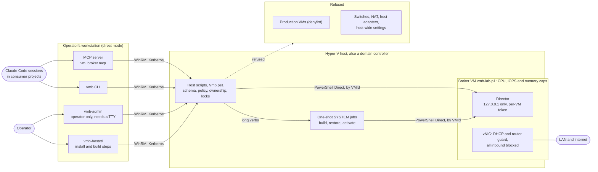
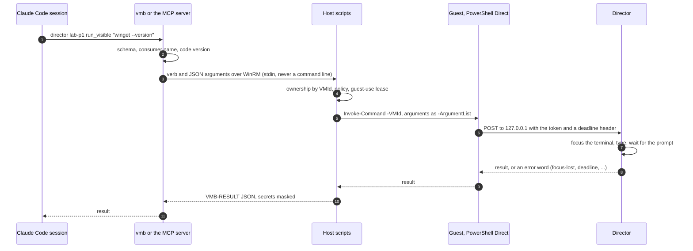

# vm-broker

**Hyper-V VMs for AI coding agents, on hosts that also run production.**

vm-broker hands out Hyper-V VMs to Claude Code sessions (through an MCP server or a plain CLI). A session writes a short
request file: a profile and a few options. The broker checks it against a closed schema and the host's policy, builds
the VM or returns the one that exists, and then offers a fixed set of verbs on it: status, power, checkpoints, running a
command, copying files, and driving and recording the desktop through an in-guest *director*. Nothing else on the host
is reachable through it.

It was built for a homelab whose two Hyper-V hosts are also domain controllers and run the production firewall. So most
of the code is guardrails:

- **Strings from a request never become code on a host.** Commands, payloads, paths and labels travel only as JSON
  values and `-ArgumentList` values, and run only inside the guest. No `Invoke-Expression`, no script text built from
  them.
- **VMs by VMId, never by name.** A VM is the broker's only when its `vmb-` name, its Notes tag and its registry record
  agree. A denylist of production VMs is checked first.
- **Caps on every broker VM:** CPU weight and limit, a disk IOPS cap, memory priority, and DHCP guard and router guard
  on every NIC, so the production VMs do not notice it.
- **No switches, NAT or host adapters,** and no host-wide Hyper-V settings changed at run time: on a domain controller,
  a new host adapter registers itself in DNS.
- **Secrets are names.** Guest passwords are generated and kept encrypted on the host, the director's token never
  leaves the guest, a licence key is never stored, and results are masked before they leave the host.
- **Long work runs as one-shot SYSTEM jobs** on the host. Every call carries a code-version check. A lock per VM and a
  guest-use lease keep jobs and guest calls apart.

## Status

This is a working homelab tool, not a product. **v0.R, the recording slice, is built and in use.** It runs one kept
Windows Server 2025 Desktop Experience VM that records lab walkthrough videos: the director opens a terminal, types
commands where the viewer can see them, moves the mouse and records the screen with ffmpeg. The VM passed its
acceptance test. Both test suites (about 250 Python tests and about 440 Pester tests) run without a host.

| stage | what it adds | state |
|---|---|---|
| v0.R | the recording VM, the director, recording, the CLI and MCP verbs, one MAK activation with guards | built |
| v0.1 | Ubuntu server and Server Core profiles, golden images, leases and destroy | designed |
| v0.2 | a Windows 11 lab profile, isolated networks behind a small router VM | designed |
| v1 | a gate on each host (SSH forced command and a SYSTEM executor), approvals, quotas | designed |
| v2 | a sandbox profile for untrusted code | idea |

The [roadmap](docs/architecture.md#14-roadmap) and the [known limits](docs/architecture.md#15-known-limits-and-open-questions)
have the details. To run it on other hosts, you adapt three things:

- the host table in [`src/vm_broker/backend/__init__.py`](src/vm_broker/backend/__init__.py);
- a policy per host in [`policy/`](policy/): the memory floor, the switch names, the denylist, and where the firewall VM
  may run;
- a credential loader script.

## How it fits together



A director call, end to end:



[docs/architecture.md](docs/architecture.md) has ten more diagrams: the components, the build job, the job lifecycle,
the trust boundaries, the recording workflow and the host's storage layout.

## Quick start

**Tests: no host needed.** The broker runs against an in-memory fake backend. The host scripts' Pester tests stub
every command that could change the machine, and the runner checks that before Pester starts.

```powershell
git clone https://github.com/mmcjcc/hyperv-vm-broker C:\work\vm-broker
python -m venv C:\work\venvs\vm-broker
C:\work\venvs\vm-broker\Scripts\python.exe -m pip install PyYAML==6.0.3          # the one dependency
cd C:\work\vm-broker
C:\work\venvs\vm-broker\Scripts\python.exe -B -m unittest discover -s tests       # Python 3.11 or later
powershell -NoProfile -File tests\ps\Run-Tests.ps1                                # Windows PowerShell 5.1, Pester 3.4
```

**The client.** Install the package into the venv (`pip install -e .` gives `vmb`, `vmb-admin` and `vmb-hostctl`). Copy
[`.env.example`](.env.example) to `%LOCALAPPDATA%\vm-broker\client.env` and fill it in. `VMB_HOSTS` lists the hosts.
`VMB_CREDENTIAL_LOADER` names a script that returns a PSCredential for an account with Hyper-V rights on them. Only
names go in that file, never a secret.

**A host** runs Windows Server 2022 or 2025 with Hyper-V. It must be reachable over WinRM with Kerberos, and the broker
needs a Windows Server 2025 ISO on it for the recording profile.

1. Add the host to `HOSTS` and write its `policy/<host>.json`, starting from the two in [`policy/`](policy/).
2. Run `vmb-hostctl --host <host> inventory` (read-only), then `install`, `set-policy` and `sync-code`.
   [docs/design.md](docs/design.md) section 3.8 lists the one-time steps; each one is the operator's call.
3. For the recording profile, [`tools/Stage-LabDirector.ps1`](tools/Stage-LabDirector.ps1) stages the director bundle:
   the Python embeddable, the `vm_director` package and ffmpeg (you download the first and last yourself). Then run
   `vmb-hostctl stage-director`.

**A consumer project** puts its name in `vmbroker/consumer` (one line), adds the MCP server once, and then uses the
same verbs as MCP tools or on the CLI, from inside its repo. [CONTRACT.md](CONTRACT.md) has the rules.

```powershell
claude mcp add --transport stdio vm-broker -- C:\work\venvs\vm-broker\Scripts\python.exe -I -m vm_broker.mcp
vmb whoami                                       # the consumer name and what this stage offers
vmb create vmbroker/lab-p1.yml                   # builds the VM, or returns the one that exists
vmb restore lab-p1 p1-ch03-start                 # a job; it waits until the director answers
vmb director lab-p1 record_start p1-ch03.mkv
vmb director lab-p1 run_visible "winget --version"
vmb director lab-p1 record_stop
vmb copy-from lab-p1 C:\ProgramData\LabDirector\out\p1-ch03.mkv   # lands in VMB_OUT_DIR, never in the repo
vmb snapshot lab-p1 p1-ch04-start
vmb wait <job id>                                # after exit 4 from a long verb
```

## Repository

| path | what it is |
|---|---|
| [`CONTRACT.md`](CONTRACT.md) | the consumer contract: what a project's session may ask for, and how |
| [`docs/architecture.md`](docs/architecture.md) | how it works, with diagrams |
| [`docs/design.md`](docs/design.md) | the full design: decisions and their reasons, guardrails, milestones, test results, open questions |
| [`docs/research/`](docs/research/) | a research pass and an adversarial code review by Grok (leads with sources, not verified facts) |
| [`src/vm_broker/`](src/vm_broker/) | the client: schema, strict YAML, validator, verbs, `vmb`, the MCP server, `vmb-admin`, `vmb-hostctl` |
| [`src/vm_broker/backend/`](src/vm_broker/backend/) | the WinRM backend, the fake backend for tests, and in [`ps/`](src/vm_broker/backend/ps/) the host scripts (Windows PowerShell 5.1) |
| [`src/vm_director/`](src/vm_director/) | the in-guest director: standard-library Python on the Python embeddable |
| [`policy/`](policy/), [`examples/`](examples/) | example host policies; the recording VM's request |
| [`skill/SKILL.md`](skill/SKILL.md) | a Claude Code skill for consumer projects (draft) |
| [`tests/`](tests/) | unit tests (`unittest`); the Pester tests of the host scripts in `tests/ps/` |
| [`tools/`](tools/) | build helpers: the director bundle, the acceptance test, job and firewall watchers |

## How it was built

Claude Code wrote it, working from the operator's spec and under the operator's rules. Three Claude review agents and
Grok Build then reviewed it adversarially, and their findings were fixed
([design.md, review notes](docs/design.md); [Grok's review](docs/research/grok-code-review-2026-10-11.md)). The host
names that remain in the docs (servera, serverd, Firewall3) come from that homelab; the domain, the addresses and the
people are replaced.

## License

MIT. See [LICENSE](LICENSE).
