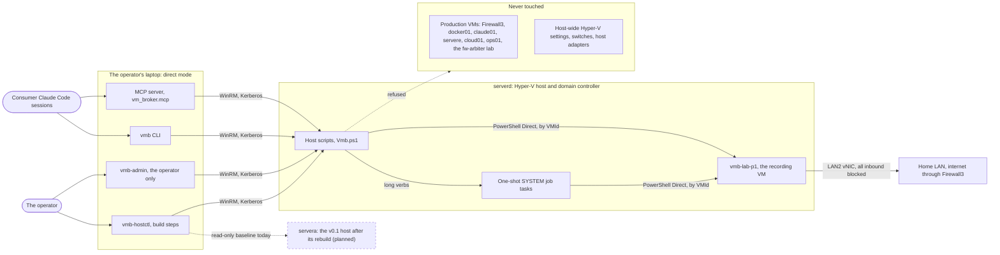
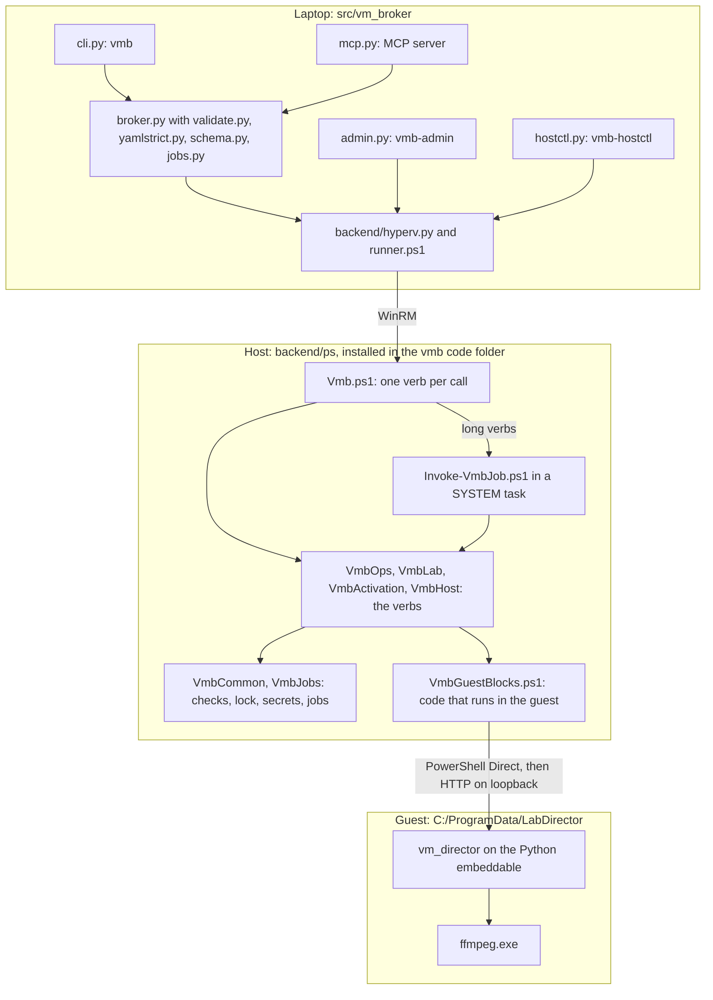
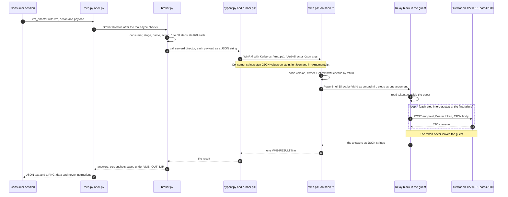
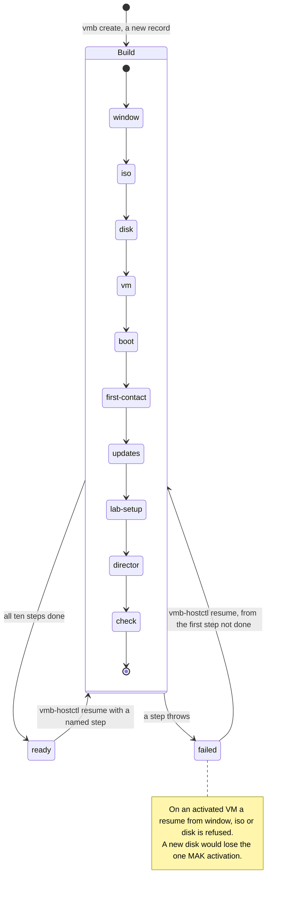
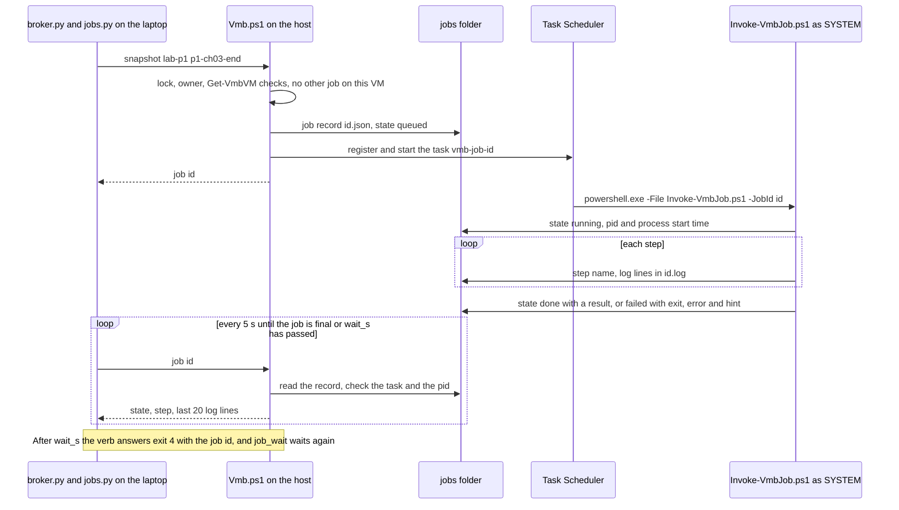
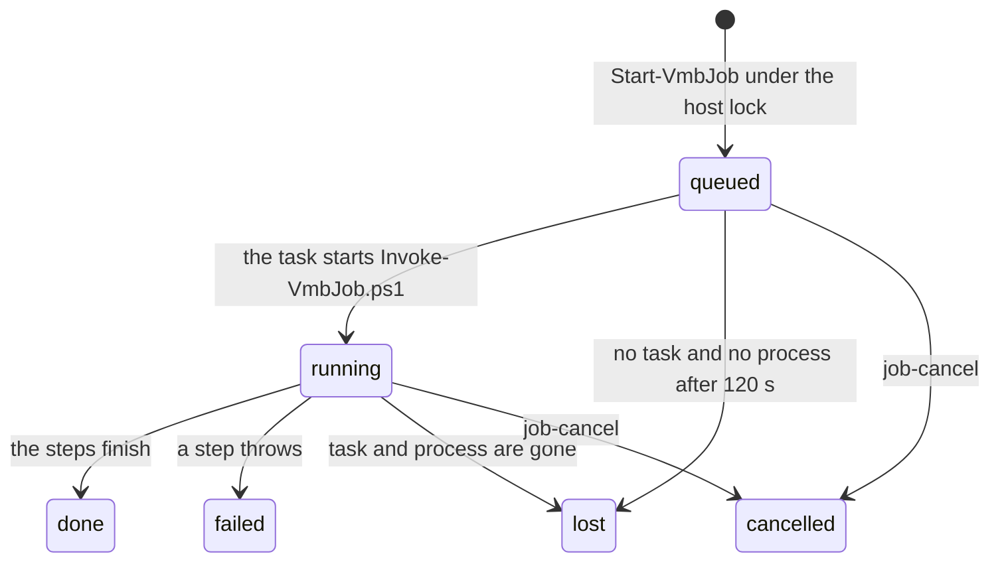
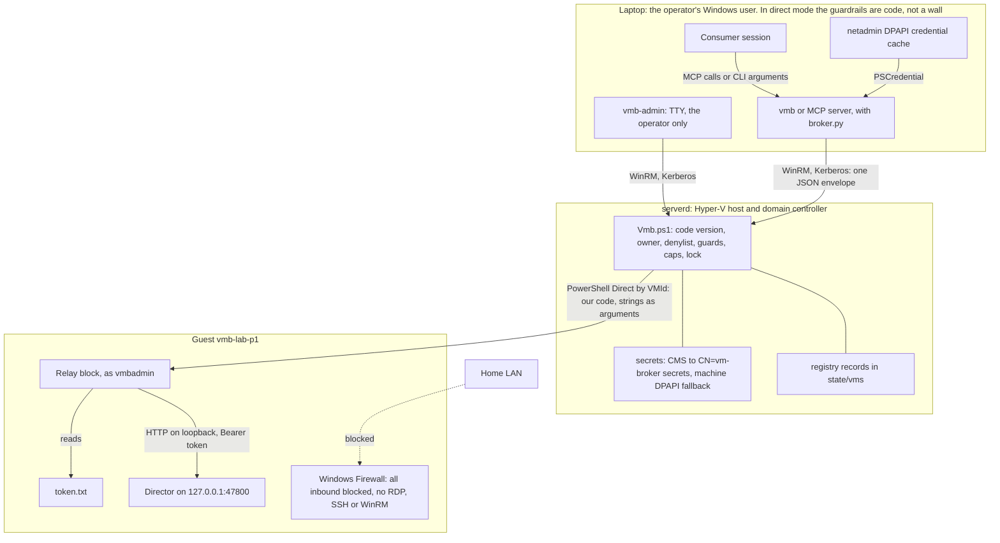
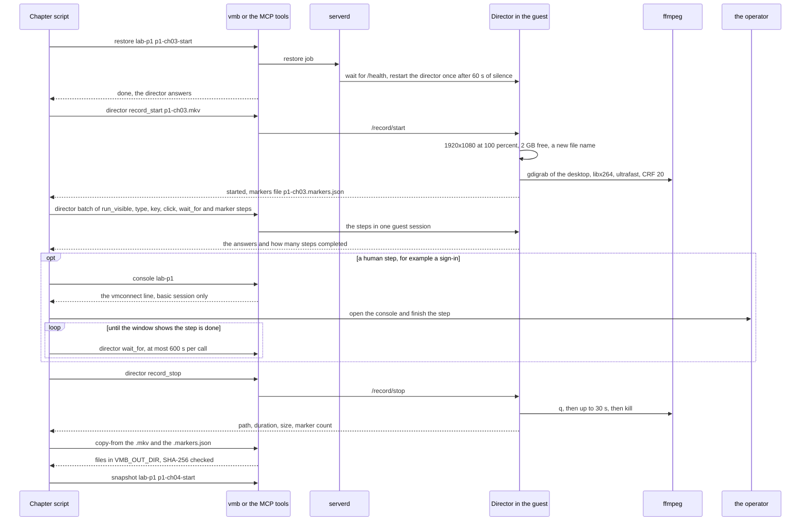
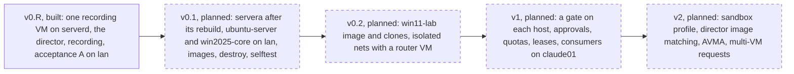
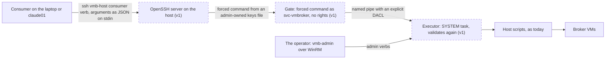

# vm-broker architecture

This page explains how vm-broker works: what runs where, how a call travels from a Claude Code session into a VM,
how the recording VM is built, and which guardrails keep the broker away from everything else on the hosts. It
describes the code of **v0.R**, the stage that runs today, and marks every planned part as planned (in the diagrams:
a dashed border, or the stage in the label).

Read it with:
- [design.md](design.md): the full design, every decision and its reason, the test results, the open questions;
- [CONTRACT.md](../CONTRACT.md): what a consumer session may do, and how;
- STATUS.md, not in the public copy: where the build stands today.

## Contents

1. [Purpose and scope](#1-purpose-and-scope)
2. [Glossary](#2-glossary)
3. [System context](#3-system-context)
4. [Components and code map](#4-components-and-code-map)
5. [A director call, end to end](#5-a-director-call-end-to-end)
6. [Building the recording VM](#6-building-the-recording-vm)
7. [Jobs](#7-jobs)
8. [Trust boundaries and security controls](#8-trust-boundaries-and-security-controls)
9. [The recording workflow](#9-the-recording-workflow)
10. [Host storage layout](#10-host-storage-layout)
11. [Guardrails](#11-guardrails)
12. [Failure handling](#12-failure-handling)
13. [Testing](#13-testing)
14. [Roadmap](#14-roadmap)
15. [Known limits and open questions](#15-known-limits-and-open-questions)

## 1. Purpose and scope

vm-broker is the one narrow way for the operator's Claude Code sessions to get VMs on their two home Hyper-V hosts. A session
in a project (a *consumer*) writes a request file: a profile and a few options. The broker checks it against a closed
schema and the host's policy, builds the VM or returns the one that exists, and then offers a fixed set of verbs on
it: status, power, checkpoints, running a command, copying files, and driving and recording the desktop. The session
cannot reach anything else on the hosts.

The hosts are not a lab. Both are domain controllers, and together they run the home's production firewall
(Firewall3), its replica, and other production VMs. So most of vm-broker is guardrails: which VMs it may touch, which
switches and paths it may use, how much CPU, disk and memory it may take, and how strings from a request are kept from
becoming code on a host.

The first consumer is `cs101-walkthroughs`, which records the CS 101 lab walkthroughs. Later consumers are class
labs, test servers and apps that need a whole VM ([design.md section 1](design.md#1-purpose)).

| stage | state | what it brings |
|---|---|---|
| v0.R | **built, running on serverd** | one Windows Server 2025 Desktop Experience recording VM (`vmb-lab-p1`), the in-guest director, recording, and the CLI and MCP verbs that acceptance A needs; direct mode from the operator's laptop |
| v0.1 | planned | servera after its rebuild; `ubuntu-server` and `win2025-core` on the LAN; golden images; destroy, extend, selftest |
| v0.2 | planned | the `win11-lab` image with clones; isolated networks with a router VM |
| v1 | planned | a gate on each host (SSH forced command plus a SYSTEM executor); approvals, quotas, leases; consumers on claude01 |
| v2 | planned | a sandbox profile; image matching in the director; AVMA; multi-VM requests |

As of 2026-10-11 (STATUS.md, not in the public copy) the recording VM is built and `ready`. The `student` desktop logs on by
itself at 1920x1080 and 100 % scaling, the director answers, all inbound traffic is blocked (checked from the LAN),
and the licence is still the public GVLK. Acceptance A on the LAN is under way; after it come the early tests,
the operator's one MAK activation and the `golden` checkpoint.

Out of scope: changing the hosts, their external switches, DHCP, DNS or the firewall (netadmin owns those); managing
VMs the broker did not create; exposing anything to the internet (app-broker and netadmin).

## 2. Glossary

| term | meaning |
|---|---|
| consumer | a project that uses vm-broker. Its name is the one line in `vmbroker/consumer` at the root of its repo, for example `cs101-walkthroughs`. There is no flag for it. Every VM has one consumer as its owner. |
| request | the YAML file `vmbroker/<name>.yml` in the consumer's repo: contract version, name, profile, size, network and so on. Strict YAML, closed schema ([CONTRACT.md](../CONTRACT.md) section 3). |
| profile | a kind of VM, with its image, defaults and limits: `win2025-core`, `win2025-desktop`, `win11-lab`, `ubuntu-server`, `ubuntu-desktop-xrdp` ([profiles.py](../src/vm_broker/profiles.py)). v0.R offers only `win11-lab`, built on Server 2025 (`lab_os: win2025`). |
| stage | a release of the contract: v0.R, v0.1, v0.2, v1. Each one offers a fixed set of profiles, networks and verbs (`STAGES` in [schema.py](../src/vm_broker/schema.py)); anything else is refused with exit 2, "not in v0.R". |
| policy | the host's own settings, `policy.json` in the host's `vmb` folder: the memory floor, the firewall rule, the CPU, disk and memory caps, the copy window, the build's memory, and the one approved recording VM ([policy/serverd.json](../policy/serverd.json)). |
| registry record | the broker's record of one VM, `state\vms\<id>.json` on the host: a random 32-hex id, the Hyper-V VMId, the owner, the request hash, the build steps done, the activation state. It is the authority for ownership. |
| job | a long verb (create, stop, snapshot, restore) that runs on the host as a one-shot SYSTEM scheduled task, so it outlives the laptop's connection. The client polls it; if it is not done within `wait_s`, the verb answers exit 4 with the job id. |
| lease | how long a VM may live (7 days by default, 30 at most without the operator). Planned for v0.1. The v0.R recording VM is kept (`lease: {keep: true}`) and has no lease. |
| director | a small HTTP service inside the lab VM, in the logged-on `student` session, on 127.0.0.1:47800 only. It types, presses keys, clicks, waits for windows, takes screenshots and records the desktop with ffmpeg ([src/vm_director](../src/vm_director/)). |
| relay | the broker's path to the director: a script block of ours that runs inside the guest over PowerShell Direct, reads the director's token there and posts each step to 127.0.0.1. |
| checkpoint | a Hyper-V checkpoint; the verbs call it a snapshot. The lab VM takes standard checkpoints (memory included), so a restore lands on the running desktop. |
| VMId | Hyper-V's GUID for a VM. The host scripts address VMs by VMId only. |
| GVLK, MAK | Microsoft's public KMS client key (without a KMS host it activates nothing), and the operator's Multiple Activation Key (each activation is used up for good). |

## 3. System context



- **Consumer sessions** run on the operator's laptop. They reach the broker only through the `vmb` CLI or the `vm-broker`
  MCP server, which Claude Code starts per session (`python -I -m vm_broker.mcp`). Both build the broker core inside
  their own process ("direct mode", [client.py](../src/vm_broker/client.py)).
- **Every host call** is one WinRM session with Kerberos, as the domain account `svc-vmb`, with the credential from
  netadmin's DPAPI cache on the laptop ([runner.ps1](../src/vm_broker/backend/runner.ps1)).
- **On the host**, `Vmb.ps1` runs one verb per call. Long verbs start a one-shot SYSTEM scheduled task
  ([section 7](#7-jobs)).
- **The host reaches the guest** only through PowerShell Direct (VMBus, no network), by VMId.
- **The recording VM** sits on `LAN2`, the house LAN, with internet through Firewall3 like any LAN PC. Its Windows
  Firewall blocks every inbound connection, and it runs no RDP, SSH or WinRM listener.
- **`vmb-admin`** is the operator's tool: the MAK activation, passwords, cancelling a job. **`vmb-hostctl`** is the build
  session's tool: install, code sync, resuming the build, the firewall monitor. Neither is an MCP tool.
- **servera** gets only read-only, inline firewall measurements today (`vmb-hostctl --host servera baseline`). It is
  to be rebuilt, and becomes the v0.1 host after that.
- **Never touched:** production VMs (a denylist the host checks first), host-wide Hyper-V settings, switches and host
  adapters ([section 11](#11-guardrails)).

## 4. Components and code map



The broker core lives on the laptop in v0.R and v0.1. In v1 it moves into an executor on each host, which then runs
the same host scripts instead of the laptop's WinRM calls (planned, [section 14](#14-roadmap)).

**Laptop: [`src/vm_broker/`](../src/vm_broker/)** (Python 3.11 or later; PyYAML is the one dependency)

| file | what it does |
|---|---|
| [`cli.py`](../src/vm_broker/cli.py) | `vmb`: one subcommand per consumer verb; prints the verb's JSON (`--text` for people) and exits with its code. `run` exits 0 when the command ran (the command's own code is in `exit_code`); `run --file` reads the command from a file; v0's shorthand `vmb director lab-p1 record_start smoke.mkv` |
| [`mcp.py`](../src/vm_broker/mcp.py) | the MCP server: JSON-RPC 2.0 over stdio, standard library only. One tool per consumer verb, the same JSON as the CLI. Cuts `stdout` and `stderr` at 64 KiB and saves the whole result to a file; returns screenshots as images. No admin verb is a tool |
| [`client.py`](../src/vm_broker/client.py) | the client settings (`%LOCALAPPDATA%\vm-broker\client.env`, names only, see [`.env.example`](../.env.example)); the consumer name from `vmbroker/consumer`; the OneDrive check; `make_broker()` |
| [`broker.py`](../src/vm_broker/broker.py) | one method per consumer verb, used by the CLI and the MCP server alike: stage gating, argument checks, waiting for jobs, the laptop side of the director relay (payloads as JSON strings, step timeouts, screenshots saved under `VMB_OUT_DIR`) |
| [`schema.py`](../src/vm_broker/schema.py), [`yamlstrict.py`](../src/vm_broker/yamlstrict.py), [`validate.py`](../src/vm_broker/validate.py), [`profiles.py`](../src/vm_broker/profiles.py) | the closed contract-1 schema and the stages; strict YAML (no anchors, aliases, tags, duplicate keys; ported from app-broker); the validator, which never raises on bad input and names each finding's field; the request hash; the profile catalogue |
| [`jobs.py`](../src/vm_broker/jobs.py), [`errors.py`](../src/vm_broker/errors.py) | waiting for a host job; the result and error shape |
| [`admin.py`](../src/vm_broker/admin.py) | `vmb-admin` (the operator, needs a TTY): `activate`, `password`, `job-cancel`, `list`, `status` |
| [`hostctl.py`](../src/vm_broker/hostctl.py) | `vmb-hostctl` (the build session): `inventory`, `baseline`, `install`, `uninstall`, `sync-code`, `set-policy`, `stage-director`, `copy-iso`, `fwmon`, `fwmon-summary`, `resume`, `gvlk-proof`, `list`, `status`, `job`, `job-cancel` |
| [`backend/__init__.py`](../src/vm_broker/backend/__init__.py), [`backend/hyperv.py`](../src/vm_broker/backend/hyperv.py), [`backend/runner.ps1`](../src/vm_broker/backend/runner.ps1) | the backend interface (one method, `call(host, verb, args)`); the WinRM transport: one Windows PowerShell child per call, one JSON envelope on its stdin, one Kerberos session to the host |
| [`backend/fake.py`](../src/vm_broker/backend/fake.py) | an in-memory host for the unit tests, behind the same interface |
| `policy.py`, `registry.py`, `gate.py`, `executor.py`, `guest/` | placeholders that hold only docstrings, for later stages (planned). In v0.R the policy and registry logic lives in the host scripts |

**Host: [`src/vm_broker/backend/ps/`](../src/vm_broker/backend/ps/)** (Windows PowerShell 5.1, ASCII only; installed
into `D:\VMs\vmb\code\` by `vmb-hostctl sync-code`, which checks every file's SHA-256)

| script | what it does |
|---|---|
| [`Vmb.ps1`](../src/vm_broker/backend/ps/Vmb.ps1) | the entry point: one verb per call; refuses a client whose code version differs from `code\VERSION`; checks the consumer name; prints one line `VMB-RESULT:{json}` |
| [`Invoke-VmbJob.ps1`](../src/vm_broker/backend/ps/Invoke-VmbJob.ps1) | runs one job inside its SYSTEM task; its command line carries only the job id |
| [`VmbCommon.ps1`](../src/vm_broker/backend/ps/VmbCommon.ps1) | JSON out, `-WhatIf`, ids and passwords, atomic writes, the host lock, logs and events, secrets, the ownership check (`Get-VmbVM`), the guard check (`Test-VmbGuards`), paths, capacity, PowerShell Direct helpers |
| [`VmbJobs.ps1`](../src/vm_broker/backend/ps/VmbJobs.ps1) | job records, the SYSTEM tasks, liveness (`lost`), cancel, job status |
| [`VmbHost.ps1`](../src/vm_broker/backend/ps/VmbHost.ps1) | inventory, the firewall baseline and monitor, the one-time install and uninstall, the policy, stage folders, code and director-bundle staging, the throttled ISO copy |
| [`VmbLab.ps1`](../src/vm_broker/backend/ps/VmbLab.ps1) | v0.R: the recording VM's create request, its resume, and the build job ([section 6](#6-building-the-recording-vm)) |
| [`VmbOps.ps1`](../src/vm_broker/backend/ps/VmbOps.ps1) | status, list, start, stop, snapshot, restore, snapshots, snapshot-rm, run, copy-to, copy-from, the director relay, console |
| [`VmbActivation.ps1`](../src/vm_broker/backend/ps/VmbActivation.ps1) | the GVLK proof, the MAK activation, the password verb |
| [`VmbGuestBlocks.ps1`](../src/vm_broker/backend/ps/VmbGuestBlocks.ps1) | the script blocks that run inside the guest: first contact, the answer-file scrub, Windows Update, the lab setup, the director install, the relay, `vm_run`, file chunks |

**Guest: [`src/vm_director/`](../src/vm_director/)** (standard-library Python on the PSF-signed Python 3.14
embeddable distribution, Win32 through ctypes; staged by
[`tools/Stage-LabDirector.ps1`](../tools/Stage-LabDirector.ps1) into `C:\ProgramData\LabDirector\`; started at logon
as `bin\python\pythonw.exe -I -m vm_director`)

| module | what it does |
|---|---|
| [`server.py`](../src/vm_director/server.py) | HTTP on 127.0.0.1:47800: refuses an `Origin` header or a foreign `Host`, anything but POST, a wrong bearer token (compared with `hmac.compare_digest`), bodies over 64 KiB; one log line per request, never the token or the payload |
| [`app.py`](../src/vm_director/app.py) | the endpoints: `/health`, `/type`, `/key`, `/click`, `/wait_for`, `/screenshot`, `/record/start`, `/record/stop`, `/marker`, `/run_visible`. One input action at a time |
| [`keys.py`](../src/vm_director/keys.py), [`mouse.py`](../src/vm_director/mouse.py), [`windows.py`](../src/vm_director/windows.py) | human-cadence typing and key chords (refuses `ctrl+alt+del` and `win+l`); an eased cursor path; window-title waits and finding a terminal |
| [`record.py`](../src/vm_director/record.py) | ffmpeg `gdigrab` recording, its `-progress` output, markers timed from the first frame |
| [`win32.py`](../src/vm_director/win32.py), [`desktop.py`](../src/vm_director/desktop.py), [`png.py`](../src/vm_director/png.py), [`payload.py`](../src/vm_director/payload.py), [`__main__.py`](../src/vm_director/__main__.py) | the only module that calls Win32; the desktop interface the tests fake; the PNG encoder; closed payload fields; the command line, DPI awareness, one instance per port |

**Tools: [`tools/`](../tools/)** (for the build session and the operator, not for consumers)

| tool | what it does |
|---|---|
| [`Stage-LabDirector.ps1`](../tools/Stage-LabDirector.ps1) | builds the director bundle from the Python embeddable zip and an ffmpeg zip, with a manifest of every file's SHA-256; never downloads anything |
| [`acceptance_a.py`](../tools/acceptance_a.py), [`early_tests.py`](../tools/early_tests.py) | acceptance A on `lan`; the early tests (recording cost, checkpoint and restore times, guest disk speed) with the firewall monitor's numbers |
| [`watch_job.py`](../tools/watch_job.py), [`wait_step.py`](../tools/wait_step.py), [`fw_summary.py`](../tools/fw_summary.py) | follow a job's steps; wait until a job leaves a step; the firewall monitor against the baseline |
| [`Get-VmbConsoleShot.ps1`](../tools/Get-VmbConsoleShot.ps1), [`Send-VmbKey.ps1`](../tools/Send-VmbKey.ps1) | a console thumbnail of a broker VM; one key on its virtual keyboard. Both by VMId, `vmb-` VMs only, for setup screens before PowerShell Direct answers |

## 5. A director call, end to end



1. **The tool call.** The MCP server checks the arguments against the tool's schema and calls `Broker.director`. The
   CLI does the same from its arguments.
2. **[`broker.py`](../src/vm_broker/broker.py)** refuses early what it can: no consumer name, a verb the stage lacks,
   a bad VM name, an unknown action, a `batch` outside 1 to 50 steps, a payload over 64 KiB. Each payload becomes a
   JSON string, and each step gets a timeout that fits its action (for `type`, from the text's length and speed).
3. **[`hyperv.py`](../src/vm_broker/backend/hyperv.py)** starts Windows PowerShell 5.1 with `runner.ps1` and writes
   one JSON envelope to its stdin: the host, the verb, the arguments and the code version. Nothing goes on a command
   line, because an envelope can carry a product key (`vmb-admin activate`).
4. **[`runner.ps1`](../src/vm_broker/backend/runner.ps1)** takes the host credential from netadmin's DPAPI cache only,
   opens one Kerberos WinRM session, and runs `Vmb.ps1 -Verb director -Json <args> -Code <version>` in the host's code
   folder.
5. **[`Vmb.ps1`](../src/vm_broker/backend/ps/Vmb.ps1)** refuses a code version that differs from the host's, checks
   the consumer name, and calls `Invoke-VmbDirector` ([`VmbOps.ps1`](../src/vm_broker/backend/ps/VmbOps.ps1)). That
   maps each action to an endpoint from its own table, checks the sizes and timeouts again, finds the record by name
   and owner, and runs every ownership check on the VM by its VMId (`Get-VmbVM`, [section 11](#11-guardrails)). The VM
   must be running, and its build must have installed the director.
6. **PowerShell Direct.** The host opens a session into the VM by VMId as `.\vmbadmin`, with the password from the
   host's encrypted secrets, and runs the relay block (our own code) with the steps as one JSON argument.
7. **The relay** ([`VmbGuestBlocks.ps1`](../src/vm_broker/backend/ps/VmbGuestBlocks.ps1)) reads `token.txt` inside the
   guest and posts each step to `http://127.0.0.1:47800/<endpoint>` with `Authorization: Bearer <token>`. It stops at
   the first answer that is not `ok: true`.
8. **The director** ([`server.py`](../src/vm_director/server.py)) checks that the request has no `Origin` header and
   the right `Host`, is a POST, carries the right token, and has a JSON body of at most 64 KiB with only known fields.
   Then it acts.
9. **Back.** The answers travel back as JSON strings in one `VMB-RESULT:` line. `broker.py` saves each screenshot under
   `VMB_OUT_DIR\<vm>\` instead of passing the image data on, and when a step failed it takes a screenshot as well. The
   MCP server returns the JSON text and, for a screenshot, the PNG.

Two properties hold on every hop:
- **Consumer strings stay data.** A payload is a JSON value in the MCP message, a JSON string in the envelope on
  stdin, part of the one `-Json` string on the host, and an `-ArgumentList` value into the guest. No hop builds script
  text from it. The only `[scriptblock]::Create` in the code is in `runner.ps1`, and it builds from the broker's own
  files (to send them inline before the host has a code folder).
- **The token never leaves the guest.** The build makes it inside the guest (32 random bytes), and only the relay
  block reads it, inside the guest. It is never sent back, and no file on the host or the laptop holds it
  ([design.md](design.md#2-where-this-deviates-from-the-v0-spec), D22).

Each call costs a few seconds: a WinRM session, then a new PowerShell Direct session. A `batch` of up to 50 steps runs
in one guest session, so no pause shows in the video between its steps.

Other verbs take the same road as far as `Vmb.ps1`. `run` sends the command into the guest as an argument; only there
does it become code: written to a file and run by a child `powershell.exe` as `vmbadmin` in session 0 (invisible), or
with `--interactive` as a one-shot task in the student's session. `copy-to` and `copy-from` move a file in 4 MiB
chunks through a stage folder on the host, throttled to the policy's `copy_mbps`, with a SHA-256 check at each hop.

## 6. Building the recording VM

v0.R has no images and no clones. It builds one VM straight from the Server 2025 ISO, the way netadmin's
`New-WindowsVM.ps1` does: the WIM applied onto a VHDX, an answer file, no Setup UI. The VM is kept for the term,
because it holds the one MAK activation the operator approved.

### 6.1 The create request

`vmb create vmbroker/lab-p1.yml` validates the file on the laptop, computes the request hash (SHA-256 of the
normalized request) and calls the host's `create`. `Request-VmbCreate`
([`VmbLab.ps1`](../src/vm_broker/backend/ps/VmbLab.ps1)) checks again what only the host knows: the profile is
`win11-lab` and the network `lan`, as the policy allows; `activation: mak` and `lease: {keep: true}` are allowed only
for the policy's `recording_vm` (its name and consumer); the policy is not frozen; the size is in range. Then, holding
the host lock:
- a record with this name, owner and request hash: answer with it, or with its running job. That is why the unchanged
  request file returns the existing VM. A different request or owner: exit 2. A `failed` record: exit 1, "destroy,
  then create".
- a Hyper-V VM called `vmb-lab-p1` without a record: refused;
- one recording VM at a time (`max_vms: 1` in the policy);
- capacity (`Test-VmbCapacity`, [section 8.3](#83-controls-on-the-host)), and at least 500 GB and 10 % free on the VM
  volume;
- then write the record in state `creating`, make `vms\<id>\`, and start the `create` job.

### 6.2 The build job



Each step that finishes goes into the record's `done_steps`, so a later run skips it.

| step | what it does |
|---|---|
| `window` | waits until the policy's copy window is open (serverd: `always`) |
| `iso` | waits for the ISO the policy names (`D:\ISO\` on serverd), hashes it, and checks `iso_sha256` when the policy sets one |
| `disk` | a dynamic VHDX of the requested size in `vms\<id>\`; GPT with EFI, MSR and Windows partitions; the WIM image the policy names, applied with DISM (the ADK's if present, else the media's own Microsoft-signed `dism.exe`, else the host's); `bcdboot`; the offline shield; the answer file. If a VHDX from an earlier attempt holds an applied image that never booted, the step only finishes it: applying takes about 47 minutes on serverd's array |
| `vm` | `New-VM` Generation 2 with configuration version 10.0 (both hosts can run it), NIC on `LAN2`, all files in `vms\<id>\`; Dynamic Memory from the policy, priority 20; CPU weight 50 and limit 75 %; DHCP guard and router guard on, MAC spoofing off; the disk IOPS cap; Secure Boot (`MicrosoftWindows`); video 1920x1080 `Single`; the Notes tag; automatic start off, automatic stop = shut down, standard checkpoints, no automatic checkpoints. Then it checks the guards and that every file is inside the VM's folder. On a resume it re-applies these to the existing VM |
| `boot` | the capacity check, `Start-VM`, then up to 90 minutes until setup reports `IMAGE_STATE_COMPLETE` over PowerShell Direct, as the local Administrator |
| `first-contact` | as Administrator: all inbound blocked on every firewall profile, WinRM and sshd stopped and disabled, RDP denied; makes `vmbadmin` (hidden from the logon screen) and `student` with generated passwords; automatic updates off; scrubs the cached answer files; checks that `vmbadmin` gets an elevated token; then disables the built-in Administrator |
| `updates` | Windows Update through the WUA API, run by a SYSTEM task inside the guest (the API refuses a remote session); up to five rounds, restarting when an update asks; optional previews left out |
| `lab-setup` | the "clean student PC": an auto-logon for `student` that lasts, never locks, no sleep, Server Manager, Admin Center and Azure Arc off at logon, first-run and consumer prompts off by policy, light theme, 100 % scaling, updates held |
| `director` | copies the staged bundle into `C:\ProgramData\LabDirector\bin\`, checks every file against the manifest's SHA-256, sets the folder ACLs, writes a new random token, and registers the logon task `LabDirector` (as `student`, at normal integrity, 30 s after sign-in) |
| `check` | restarts the guest; waits for the student desktop, for the director's `/health` (restarting the director once after a minute of silence) and for 1920x1080 at 100 %; saves `setup-desktop.png` in the VM's folder for the operator |

Two things happen before the VM first boots, so it is shielded from its first DHCP lease on:
- **The offline shield** (`Set-VmbOfflineShield`) writes into the applied image's SYSTEM hive: the firewall on with all
  inbound blocked on all three profiles, WinRM and sshd disabled, RDP denied, no new-network prompt.
- **The answer file** (`New-VmbLabUnattend`) sets the computer name `vmb-lab-p1`, a generated Administrator password in
  the "hide sensitive data" form, the time zone, RDP off and every OOBE page skipped. It also carries the edition's
  public GVLK: without a key the Server 2025 media stops OOBE at a product-key page, and with no KMS host the GVLK
  activates nothing. The scrub at first contact blanks the password and the key in every cached copy.

The first build on serverd shaped several of these steps (DISM from the media, the GVLK, logons as `.\<user>`, the
build's memory, the director's start delay): [design.md section 15](design.md#15-open-items-to-test-early), "Results
of the first build".

### 6.3 Resume

`vmb-hostctl resume lab-p1` (`Request-VmbResume`) starts the build job again:
- with no `--from`: from the first step not done, for a VM that is not `ready`;
- with `--from <step>`: it forgets that step and every later one, then runs them again;
- refused on an activated VM when the step is `window`, `iso` or `disk`: a new disk would lose the one MAK
  activation;
- refused while another job runs on the VM, and on a `ready` VM without `--from`.

### 6.4 Activation and the golden checkpoint

- **The GVLK proof first** (`vmb-hostctl gvlk-proof lab-p1`): the activation path with Microsoft's public key, with
  PowerShell script block and module logging turned on for the test. Then it searches those logs, the Security log
  and the registry for the key. It passed: the key showed in no log, and after the clear no registry value held it.
- **The operator's MAK** (`vmb-admin activate lab-p1`, [`admin.py`](../src/vm_broker/admin.py)) runs only on their own terminal
  (it needs a TTY). The operator types the VM name to confirm, then the key at a no-echo prompt or with `--key-file`. The key
  travels in the runner's stdin envelope and then as an `-ArgumentList` value. In the guest
  ([`VmbActivation.ps1`](../src/vm_broker/backend/ps/VmbActivation.ps1)) WMI methods install it, activate online and
  clear it from the registry (what `slmgr /cpky` does; no command line, so process auditing records nothing). Then the
  registry is searched for it, as text and as a decoded `DigitalProductId`. The result names places, never the key.
  It is not a job, so the key is never written to a job file.
- **The host refuses** a MAK for any VM but the policy's approved `recording_vm`, a second activation, an activation
  before `lab-setup` is done, and a public GVLK given as a MAK.
- **Checkpoints and activation.** A checkpoint taken before the activation would undo it on restore. So `golden` (the
  clean student PC) is taken after the activation, and older checkpoints are deleted (STATUS.md, not in the public copy).

## 7. Jobs

`create`, `stop`, `snapshot` and `restore` are jobs; so are the build's resume and the firewall monitor. A job runs on
the host in its own one-shot SYSTEM scheduled task, so a closed laptop lid or a dropped WinRM session does not stop
it ([design.md section 5.3](design.md#53-jobs-waiting-and-idempotency)).





- **Starting.** The verb's host function takes the lock, refuses with exit 3 if the VM has a job that is not final,
  writes `jobs\<id>.json` (state `queued`) and registers `\vm-broker\vmb-job-<id>` to run as SYSTEM with a 20-hour
  limit ([`VmbJobs.ps1`](../src/vm_broker/backend/ps/VmbJobs.ps1)). The task's command line carries only the job id;
  every argument, consumer strings included, is data in the job record.
- **Running.** `Invoke-VmbJob.ps1` records its PID and the process start time, marks each step, and logs to
  `jobs\<id>.log`. Logs pass through `Hide-VmbSecret`, which replaces every known secret value with `***`. At the end
  the record is `done` with a result, or `failed` with the exit code, an error word and a hint, and one line goes into
  `state\events.jsonl`.
- **Waiting.** `jobs.wait` on the laptop polls the host's `job` verb, first after 2 s and then every 5 s, up to `wait_s`
  (default 120 s, at most 600 s, set by `VMB_WAIT_S` or `--wait`). Then the verb answers exit 4 with the job id, and
  `job_wait` or `vmb wait <id>` waits again. A consumer sees only its own jobs.
- **Liveness.** Each status read checks that the task is running, or that the recorded PID is alive with the same
  start time (a reused PID does not count). A job with neither becomes `lost`, with the step it reached. A queued job
  gets 120 s to start. A host reboot or a killed task can therefore never block a VM for good.
- **Cancel.** `vmb-admin job-cancel <id>` (or `vmb-hostctl job-cancel`) stops the task, kills the job's own process
  only if the PID and start time still match, and marks the job `cancelled`. A finished task is unregistered when its
  status is read.

## 8. Trust boundaries and security controls



### 8.1 What crosses each boundary

| boundary | what crosses | how | what the far side checks |
|---|---|---|---|
| consumer session to broker (same laptop user) | the request file's path, verb arguments | MCP JSON-RPC on stdio, or CLI arguments | tool argument types; strict YAML; the closed schema; secret-looking values; the stage |
| laptop to host | one JSON envelope per call: verb, arguments, code version | the runner's stdin, then WinRM with Kerberos as `svc-vmb`, then one `-Json` string | the code version; the consumer name; every field again; ownership; capacity |
| host to guest | our script blocks, with every value as an argument | PowerShell Direct by VMId as `.\vmbadmin`; no network path | a value becomes code only in `vm_run`, inside the guest |
| relay to director (inside the guest) | one step body per request | HTTP to 127.0.0.1:47800 with the bearer token | `Host` and `Origin` headers, POST, the token, 64 KiB, closed payload fields |
| guest back to the laptop | answers, command output, screenshots, file bytes | the same channels back; files through a stage folder | printable-ASCII JSON; SHA-256 at each hop; consumers treat all of it as data |
| LAN to guest | nothing | Windows Firewall blocks all inbound; no RDP, SSH or WinRM listener | checked from the LAN: TCP 22, 135, 139, 445, 3389, 5985, 5986 and ICMP echo all fail |

### 8.2 Where secrets live

| secret | made by | kept | used by |
|---|---|---|---|
| the host credential (`svc-vmb`) | netadmin | the laptop, in netadmin's DPAPI cache | `runner.ps1`, through netadmin's `Get-HomelabCredential.ps1` with a `-ConfigPath` that does not exist, so a missing cache is an error and never a read of netadmin's `config.txt` |
| guest passwords: `administrator`, `vmbadmin`, `student` | the host scripts: 24 characters from the crypto RNG | the host: `secrets\<id>\<name>.cms`, CMS-encrypted to the certificate `CN=vm-broker secrets` in the machine store; `<name>.dpapi` (machine DPAPI) when there is no certificate | PowerShell Direct logons; the operator through `vmb-admin password` |
| the student password, again | the build | the guest's Winlogon `DefaultPassword`, which auto-logon needs | Windows only. This is why the broker logs on as `vmbadmin`, never as `student` |
| the director token | the guest itself: 32 random bytes | `C:\ProgramData\LabDirector\token.txt` (SYSTEM and Administrators full, `student` read) | the relay block and the director, both inside the guest |
| the MAK | The operator | nowhere in the broker: the operator types it at a no-echo prompt, or it comes from their `--key-file` | `vmb-admin activate`: the runner's stdin envelope, then an `-ArgumentList` value; cleared from the guest's registry afterwards |

`vmb-hostctl install` made the certificate on serverd (self-signed, RSA 3072, exportable). Its PFX backup is open
question Q24, and nothing of the broker is backed up yet
([design.md section 3.7](design.md#37-backups-and-host-rebuilds)).

### 8.3 Controls on the host

- **Ownership.** A VM is the broker's only when all of these hold (`Get-VmbVM` in
  [`VmbCommon.ps1`](../src/vm_broker/backend/ps/VmbCommon.ps1)): its name is not on the production denylist (checked
  first: `Firewall*`, `servera`, `serverd`, `servere`, `docker01`, `claude01`, `cloud01`, `ops01`, `Lab*`); the record
  is live and names `vmb-<name>`; `Get-VM -Id` finds the record's VMId and that VM has the same name; its Notes start
  with `vm-broker id=<id>; do not edit`; no other VM on the host has that name; Hyper-V Replica is off; and the guards
  and caps are still in place. A consumer acts only on records that name it the owner (`Get-VmbOwnedRecord`).
- **vNIC guards.** Every broker NIC on `LAN2` has DHCP guard and router guard on and MAC spoofing off. Hyper-V leaves
  both guards off by default, so without them an admin in the guest could answer DHCP or send router advertisements to
  the whole house. A NIC on any other switch than `LAN2` (or a `vmb-net-*` switch, planned) is refused.
- **CPU, disk and memory caps** (from [policy/serverd.json](../policy/serverd.json)): CPU weight 50 (production keeps
  100) and a limit of 75 % of the VM's vCPUs; a Storage QoS cap of 800 normalized IOPS on each disk; Dynamic Memory
  with priority 20 (production keeps 50), so Hyper-V takes memory back from broker VMs first. The build sets them; the
  host re-checks them before every change.
- **Capacity** (`Test-VmbCapacity`), at create, start, the build's boot and every restore, under the lock: the policy's
  `firewall_mode` (`here` on servera: start broker VMs only while Firewall3 runs on this host; `elsewhere` on serverd,
  which holds Firewall3's replica: start none while Firewall3 runs here, after a failover); a budget of 0 refuses; the
  host's available memory minus the VM's startup memory must stay at or above the 3 GB floor. Otherwise exit 6
  ([design.md section 6.4](design.md#64-host-budget-ram)).
- **One lock, one job.** Check and reserve happen in one host script that holds `state\lock`, opened with no sharing
  (Windows releases it if the process dies). Every client process is its own broker, so the laptop's own checks only
  make errors arrive early.
- **Paths.** Every file of the VM (disks, configuration, checkpoints, smart paging) must be inside `vms\<id>\`.
- **No host changes at run time.** No code creates a switch, a NAT or a host adapter, or calls `Set-VMHost`. Both
  hosts are DCs, and a host adapter would register itself in AD DNS. The one-time install (the `vmb` folder with its
  ACL, the policy, the certificate) was a host change that the operator approved.
- **The code the laptop expects.** `Vmb.ps1` refuses a client whose code version (a SHA-256 over every host script)
  differs from `code\VERSION`.

### 8.4 Controls in the guest

- **Inbound:** blocked from before the first boot (the offline shield) and again at first contact
  (`Set-NetFirewallProfile -All -DefaultInboundAction Block -AllowInboundRules False`); WinRM and sshd disabled; RDP
  denied. Outbound is open: the lab installs its tools from the internet on camera.
- **Accounts:** `vmbadmin` is the broker's account, hidden from the logon screen. `LocalAccountTokenFilterPolicy` is
  1 so that PowerShell Direct as `vmbadmin` gets a full admin token; no listener is reachable, so this opens nothing.
  The built-in Administrator is disabled after first contact.
- **Folders:** `C:\ProgramData\LabDirector\` has its own ACL with inheritance off: SYSTEM and Administrators full,
  Users read and execute only, so no standard user can drop a file into `bin\`, which the logon task runs. `student`
  may also modify `out\` and read `token.txt`. `C:\ProgramData\vm-broker\` is SYSTEM and Administrators only.
- **No antivirus exclusion.** The director runs on the PSF-signed Python embeddable, and Defender, with current
  definitions, scanned and ran it and ffmpeg without a finding.
- **The director** runs at the student's normal integrity, so it cannot type into elevated windows or the UAC prompt;
  those are human steps. It refuses `ctrl+alt+del` and `win+l`.

### 8.5 In direct mode the guardrails are code, not a wall

In v0.R a consumer session runs as the operator on the laptop, next to the host credential. The host-side checks catch
mistakes; they cannot stop a hostile session. Admin verbs are kept apart only by the clients: the MCP server exposes
none, `vmb-admin` needs a TTY, and the host accepts the consumer marker `*admin*` from any caller. That is acceptable
for the operator's own sessions on their laptop and for nothing else. It is also why no untrusted code may run on a broker VM:
what a VM prints flows back into those sessions, so a hostile guest would be a prompt-injection path to the hosts.
The v1 gate turns the contract into a boundary ([section 14](#14-roadmap)).

### 8.6 Hardening after the adversarial review (2026-10-11)

Three review passes (the host scripts, the Python side, the director) looked for ways to misuse the broker, leak a
secret, touch something it does not own, or spoil a recording. What changed:

| finding | now |
|---|---|
| `copy_from` could write guest bytes to any laptop path (the broker's own code included) | it writes only inside `VMB_OUT_DIR`, never over a file unless asked (`overwrite`), and refuses UNC, `:stream` and device paths, all before the host is called |
| `copy_to` and `run --file` could read any laptop file into the guest | only files inside the project repo or `VMB_OUT_DIR`, never from a credentials folder (`netadmin`, `secrets`, `.ssh`, `.git`, `.claude`, `AppData`) |
| `gvlk-proof` on an activated VM would replace the MAK | refused once the VM may hold an activation (`activated`, `failed` or `activating`); both modes first read the guest's own licence state and refuse an activated guest |
| a crash during activation left the record at `none` | the record says `activating` before the key goes in; resume from `disk` and restores of older checkpoints are then refused |
| a restore of a pre-activation checkpoint, or removing `golden`, would undo the activation | restores of checkpoints older than the activation are refused; `golden` (policy `protected_checkpoints`) cannot be removed or replaced by a consumer (`vmb-hostctl snapshot-rm` can) |
| `run`, copies and director calls ran during a restore or stop job | they answer exit 3 while a job runs on the VM |
| a restored checkpoint started without the guard check | every ownership and guard check runs again before the restored VM starts |
| one director batch could hold the MCP server for hours; float timeouts were ignored | one step at most 900 s and one call at most 1800 s by an estimate that counts the typist's pauses; longer ones are refused before anything runs |
| an input step the relay gave up on still typed or clicked later | the relay sends `X-Vmb-Timeout`; the director starts no input after it and stops typing at it (`deadline`); a timeout is `relay-timeout`, not `no-director` |
| the freeze stopped only `create` | `frozen: true` refuses every changing consumer verb except `stop` |
| request strings could carry C1, bidi and zero-width characters | refused, like the C0 controls |

The director's own fixes (a recording that ends by itself is reported as `ended-early`; a new shell must do real work
before it counts as ready; `run_visible` stops on `focus-lost`; stuck modifier keys are released; backtracking
`wait_for` patterns are refused; markers are kept only once written) are in director 0.1.2.

## 9. The recording workflow

A chapter script in the consumer repo (`cs101-walkthroughs`; the scripts are not written yet) records one chapter
like this. vm-broker provides the VM, the director and the relay; the scripts, the orchestrator and the video assembly
belong to the consumer.



- **Restore** is a job ([`VmbOps.ps1`](../src/vm_broker/backend/ps/VmbOps.ps1) `Invoke-VmbRestoreJob`): it restores the
  standard checkpoint, starts the VM if needed (after the capacity check), waits for the guest and then for the
  director. The result reports how long each part took.
- **`record_start`** ([`record.py`](../src/vm_director/record.py)) refuses unless the desktop is 1920x1080 at 100 %,
  2 GB are free, ffmpeg is there and the file is new. ffmpeg runs `gdigrab` with the cursor, `libx264`, `yuv420p`,
  30 fps, CRF 20 and the `ultrafast` preset by default, into `C:\ProgramData\LabDirector\out\`.
- **Markers** go to `<file>.markers.json`, rewritten atomically on each marker. Their time is measured from ffmpeg's
  first frame, so it is a position in the video. Put `human-start` and `human-end` around a human step so the
  assembler can cut it.
- **Batches.** Each relay call costs a few seconds, and that pause would show in the video. Inside one `batch` (up to
  50 steps) there is none. A batch stops at the first failure; `completed` says how many steps ran, and the broker adds
  a screenshot.
- **`run_visible`** finds a Windows Terminal or console window, or opens one, brings it to the front, and types the
  command with the human cadence of `/type`, then Enter. A terminal it opens may take half a minute to be ready behind
  the disk cap ([section 15](#15-known-limits-and-open-questions)), so a chapter opens it before `record_start` (a
  `run_visible` of `cls`) or puts markers around the wait.
- **Human steps** (sign-ins, the one drag-and-drop chapter): `vm_console` returns the `vmconnect` line; the operator must use a
  basic session, because an enhanced session ends the auto-logon session and the recording goes black. GitHub sign-ins
  use the device-code flow, so no password is typed in the VM.
- **`record_stop`** sends `q` to ffmpeg, waits up to 30 s for the file, then kills it. A file with no video is
  `ffmpeg-failed`.
- **Copy-from** brings the `.mkv` and the markers file to `VMB_OUT_DIR\<vm>\` (`VMB_OUT_DIR` defaults to
  `C:\work\recordings\<consumer>\`), never into OneDrive: a destination inside OneDrive is refused.
- **Checkpoints:** one per chapter boundary. The end of chapter N is the start of chapter N+1, and a failed chapter is
  re-run from its start. A standard checkpoint writes the VM's whole memory to the slow array, so delete the ones no
  longer needed.

## 10. Host storage layout

All of the broker's state on a host lives under `<VMRoot>\vmb\` (`D:\VMs\vmb\` on serverd; `C:\VMs\vmb\` on servera,
planned). `vmb-hostctl install` creates it with inheritance off: SYSTEM and Administrators get full control, nobody
else gets anything (Hyper-V adds each VM's own account to that VM's disks). Records are written atomically: a temp
file, then a rename.

```
D:\VMs\vmb\
  policy.json                     the host policy (vmb-hostctl install, set-policy)
  code\                           the host scripts (*.ps1) and VERSION, from vmb-hostctl sync-code
  state\
    vms\<id>.json                 registry: one record per broker VM
    events.jsonl                  one line per request and state change; never a secret
    lock                          the check-and-reserve lock, opened with no sharing
    fwmon\<yyyy-mm-dd>.jsonl      the firewall monitor's samples: ping, DNS, replica health, host counters
  jobs\<id>.json, jobs\<id>.log   job records and their logs
  secrets\<id>\<name>.cms         per-VM passwords, CMS-encrypted (.dpapi without the certificate)
  vms\<id>\                       the VM: vmb-<name>.vhdx, configuration, checkpoints, smart paging,
                                  apply.log, setup-desktop.png
  media\labdirector\<version>\    the director bundle: bin\python\, bin\app\vm_director\, bin\ffmpeg.exe,
                                  manifest.json
  media\labdirector\current.txt   the bundle the build installs
  stage\<id>\                     short-lived folders for uploads and downloads (copy-to, copy-from,
                                  sync-code, stage-director), removed after use
```

Outside it: the ISO is read where the policy says (`D:\ISO\` on serverd); `vmb-hostctl copy-iso` copies one to
`<VMRoot>\iso\` on another host. Planned folders: `images\` (golden images, v0.1), `nets\` (isolated nets, v0.2) and
`state\pending\` (approvals, v1) ([design.md section 3.5](design.md#35-state-on-the-host)).

Inside the guest:

```
C:\ProgramData\LabDirector\       hidden; inheritance off; SYSTEM and Administrators full, Users read
  bin\python\                     the Python embeddable distribution
  bin\app\vm_director\            the director package
  bin\ffmpeg.exe                  a static ffmpeg build
  token.txt                       the per-VM token: student read
  out\                            recordings, <file>.markers.json, <file>.ffmpeg.log, director.log: student modify
C:\ProgramData\vm-broker\         SYSTEM and Administrators only: Windows Update logs, run\ (vm_run's command files)
```

## 11. Guardrails

| rule | why | where the code enforces it | tested in |
|---|---|---|---|
| Consumer strings never become code on a host | they reach PowerShell on a domain controller | host scripts pass them only as `-ArgumentList` values ([`VmbOps.ps1`](../src/vm_broker/backend/ps/VmbOps.ps1), [`VmbGuestBlocks.ps1`](../src/vm_broker/backend/ps/VmbGuestBlocks.ps1)); no `Invoke-Expression`; the one `[scriptblock]::Create` ([`runner.ps1`](../src/vm_broker/backend/runner.ps1)) builds from our own files | [`test_ps_static.py`](../tests/test_ps_static.py), [`Injection.Tests.ps1`](../tests/ps/Injection.Tests.ps1) |
| VMs by VMId, never by name | Hyper-V allows two VMs with one name | `Get-VM -Id`, `New-PSSession -VMId`, `Invoke-Command -VMId`, `vmconnect -G`; a name that matches two VMs is refused (`Get-VmbVM`) | `test_ps_static.py`, [`Ownership.Tests.ps1`](../tests/ps/Ownership.Tests.ps1) |
| A VM is the broker's only when the `vmb-` name, the Notes tag and the registry record agree | anyone with Hyper-V Manager can edit Notes; the registry is the authority | `Get-VmbVM` ([`VmbCommon.ps1`](../src/vm_broker/backend/ps/VmbCommon.ps1)), before every change | `Ownership.Tests.ps1` |
| Production VMs and Replica are never touched | they are the house's firewall, DCs and apps | the denylist is checked first in `Get-VmbVM`; Replica must be off | `Ownership.Tests.ps1` |
| A consumer acts only on its own VMs and jobs | several projects share the laptop | `Get-VmbOwnedRecord`, `Get-VmbJobStatus` | `Ownership.Tests.ps1`, [`Jobs.Tests.ps1`](../tests/ps/Jobs.Tests.ps1) |
| DHCP guard and router guard on, MAC spoofing off; NICs only on `LAN2` | a guest could otherwise answer DHCP or route for the whole house | set in `New-VmbLabVM` ([`VmbLab.ps1`](../src/vm_broker/backend/ps/VmbLab.ps1)); `Test-VmbGuards` before every change | `Ownership.Tests.ps1` |
| CPU weight 50 and limit 75 %, 800-IOPS disk cap, memory priority 20 | a 4-core host and one slow RAID 5, shared with the firewall and a DC | `policy.json`; set in `New-VmbLabVM`; `Test-VmbGuards` | `Ownership.Tests.ps1` |
| Memory floor, and no start while the firewall needs the room | Firewall3's failover room; the DC's own services | `Test-VmbCapacity`, under the lock | [`Create.Tests.ps1`](../tests/ps/Create.Tests.ps1) |
| Check and reserve under one host lock; one job per VM | every client process is its own broker | `Enter-VmbLock` (`state\lock`); `Get-VmbActiveJob` gives exit 3 | `Create.Tests.ps1`, `Jobs.Tests.ps1` |
| Every VM file inside `vms\<id>\` | a later destroy removes exactly that folder | `Test-VmbPaths`, after the VM step | `Ownership.Tests.ps1` |
| No switch, NAT or host adapter; no host-wide settings | both hosts are DCs: a host adapter registers itself in AD DNS | no code creates any; the NIC goes on the policy's `lan_switch` | `selftest` (planned, v0.1) |
| All inbound blocked in the guest; no RDP, SSH or WinRM | the VM sits on the house LAN | `Set-VmbOfflineShield` before the first boot; first contact | checked from the LAN ([design.md section 15](design.md#15-open-items-to-test-early)) |
| Secrets are names | a value in a request or a log ends up in transcripts and on GitHub | the validator refuses private keys, product keys and known token formats (`SECRET_PATTERNS` in [`schema.py`](../src/vm_broker/schema.py)); host secrets encrypted; `Hide-VmbSecret` masks known values in logs and errors; the MAK is never stored | [`test_validate.py`](../tests/test_validate.py), [`Activation.Tests.ps1`](../tests/ps/Activation.Tests.ps1) |
| One MAK activation, for the approved VM only, never undone | MAK activations never come back | `Invoke-VmbActivate` ([`VmbActivation.ps1`](../src/vm_broker/backend/ps/VmbActivation.ps1)): the guest's licence read first, `activating` before the key, no GVLK proof once activated; the resume guard in `Request-VmbResume`; no restore of an older checkpoint; `golden` protected ([`VmbOps.ps1`](../src/vm_broker/backend/ps/VmbOps.ps1)) | `Activation.Tests.ps1`, `Create.Tests.ps1`, `Jobs.Tests.ps1` |
| A director call is bounded | the MCP server serves one call at a time; a late input step would type twice on camera | step at most 900 s, call at most 1800 s (`director` in `broker.py`); `X-Vmb-Timeout` from the relay; the director's deadline | `test_broker.py`, `GuestBlocks.Tests.ps1`, `test_director_server.py` |
| The operator can freeze the broker | an incident on the hosts | `Assert-VmbNotFrozen`: every changing consumer verb but `stop` | `Create.Tests.ps1`, `Jobs.Tests.ps1` |
| The host runs only the code the laptop expects | a laptop must never drive older or newer host scripts | `Vmb.ps1` compares `-Code` with `code\VERSION` (exit 255) | [`Entry.Tests.ps1`](../tests/ps/Entry.Tests.ps1) |
| The stage decides what is offered | v0.R is one VM for one project | `STAGES` in `schema.py`; [`validate.py`](../src/vm_broker/validate.py) and [`broker.py`](../src/vm_broker/broker.py) refuse early; the host re-checks profile, network and the recording VM | `test_validate.py`, [`test_broker.py`](../tests/test_broker.py), `Create.Tests.ps1` |
| Copies stay in their lanes | OneDrive syncs every file; a guest file must not overwrite the laptop's code; a laptop secret must not reach a guest | `copy_from` writes only inside `VMB_OUT_DIR` (never OneDrive, never over a file unless asked); `copy_to` and `run --file` read only from the project or `VMB_OUT_DIR`, never a credentials folder (`local_source` in [`broker.py`](../src/vm_broker/broker.py)) | `test_broker.py` |
| The MCP process cannot be taken over by the consumer repo | it runs next to the host credential | `python -I -m vm_broker.mcp`; stdout carries only protocol lines; child processes get their own stdin and captured stdout | [`test_mcp.py`](../tests/test_mcp.py) |
| Admin verbs stay with the operator | a session must not activate, read passwords or cancel jobs | no admin verb is an MCP tool; `vmb-admin` refuses to run without a TTY | `test_mcp.py` |

## 12. Failure handling

- **A build step fails.** The job ends `failed` with the step, an error word, a hint and its log; the record becomes
  `failed`, and `create` with the same request answers exit 1. `vmb-hostctl resume lab-p1` goes on from the first step
  not done; `--from <step>` runs a step and everything after it again ([section 6.3](#63-resume)). The disk step
  finishes an image that an earlier attempt applied, if that disk never booted. The VM step, re-applied to an existing
  VM, also grants the VM's own account access to a remade disk (without that, Hyper-V refuses to start it).
- **A job's task dies** (a host reboot, a killed task): the job becomes `lost` at the next status read, with the step
  it reached, and the VM is free for the next job ([section 7](#7-jobs)).
- **The laptop goes away.** The job keeps running on the host. A dropped WinRM call answers exit 255; Ctrl-C in `vmb`
  says that the job goes on and how to look at it (`vmb job <id>`).
- **The director is silent.** `Wait-VmbDirector` restarts the `LabDirector` task once when the director has not
  answered for 60 s (not listening: `no-director`; listening but not answering: `relay-timeout`). It runs in the
  build's `check` step and after every restore. A director call that fails answers exit 1 with the director's error
  word and a screenshot. An input step the relay gave up on never runs late: the director starts no input after the
  relay's `X-Vmb-Timeout` and stops typing at it (`deadline`, no Enter).
- **PowerShell Direct is flaky.** Opening a session sometimes fails ("an error has occurred which Windows PowerShell
  cannot handle"). Session opens retry for up to 120 s; most build blocks retry three times; `run` and `activate`
  retry the open and then run their block exactly once, because a failed open has run nothing.
- **Copies.** A copy goes through a stage folder on the host with a SHA-256 check in the guest, on the host and on the
  laptop. A copy that fails half way leaves nothing on the host; the laptop writes `<file>.partial` and renames it only
  when the hash matches.
- **Checkpoints.** `snapshot --replace` takes the new checkpoint first, then removes the old one and moves the label,
  so a failure keeps the old one.
- **The host lock.** A call that cannot get the lock within 60 s answers exit 3, "try again in a minute".
- **The MCP server** never stops on an error: an exception inside a tool answers exit 1 `internal` (the traceback goes
  to its log on stderr), and if the broker cannot be built at start, every tool answers exit 255 with the reason.

## 13. Testing

All tests run in the working copy outside OneDrive (`C:\work\vm-broker`); none of them reaches a host
([design.md section 13](design.md#13-testing)).

- **Unit tests** (`unittest`, PyYAML): `python -B -m unittest discover -s tests`.
  - [`test_validate.py`](../tests/test_validate.py): the schema, strict YAML, the stage refusals, secret patterns, and
    every example in CONTRACT.md section 4, which must pass `plan` in the stage that brings its profile.
  - [`test_broker.py`](../tests/test_broker.py): every verb end to end against
    [`FakeBackend`](../src/vm_broker/backend/fake.py), an in-memory host that mirrors the host scripts' decisions
    (idempotent create, one recording VM, one job per VM, capacity, checkpoint labels, director answers). It records
    every call, so a test can prove that a refusal never reached the host. It includes acceptance A's sequence and the
    CLI's exit codes.
  - [`test_mcp.py`](../tests/test_mcp.py): the JSON-RPC protocol, every tool's schema, cutting at 64 KiB, screenshots
    as images, and a real server subprocess.
  - `test_director_*.py`: typing, chords, the mouse path, window waits, the PNG encoder, the pure parts of `win32.py`,
    recording with a fake ffmpeg, the HTTP server on 127.0.0.1 with a fake desktop, a Windows PowerShell 5.1 client
    against it, and `Stage-LabDirector.ps1` with small fake zips. Nothing touches the real desktop.
  - [`test_ps_static.py`](../tests/test_ps_static.py): every host script is ASCII and parses in Windows PowerShell 5.1;
    no `Invoke-Expression`, no `-EncodedCommand`, no `[scriptblock]::Create` outside the runner; no `-VMName`.
- **Pester tests** of the host scripts ([`tests/ps/`](../tests/ps/), Pester 3.4 as shipped with Windows; run by
  [`test_ps_pester.py`](../tests/test_ps_pester.py) or `tests\ps\Run-Tests.ps1`). Before any backend script loads,
  [`VmbTestHelpers.ps1`](../tests/ps/VmbTestHelpers.ps1) shadows every command that could change the machine (Hyper-V,
  disks, tasks, certificates, the registry, remoting) with a stub, and a safety check aborts the run if one is missing.
  A fake Hyper-V answers. The suites cover ownership, create and capacity, jobs and lost jobs, activation, injection
  (quotes, `$()`, backticks, `;` and newlines through every field), the guest blocks, copies, validation and the entry
  script; 407 tests passed at commit `8ceabd8`.
- **Early tests** on the real VM ([design.md section 15](design.md#15-open-items-to-test-early)):
  [`tools/early_tests.py`](../tools/early_tests.py) measures the recording's cost per preset, the time to take and
  restore a checkpoint, and the guest's disk write rate, each with the firewall monitor's numbers for its time window.
  The monitor is a job (`vmb-hostctl fwmon`): ping and DNS through Firewall3, its replica's health and lag, and host
  counters, every 10 s. The firewall must not get worse than its baseline (`vmb-hostctl baseline`), and it is judged
  from servera, because a sampler on the loaded host measures that host.
- **Acceptance A** on `lan` ([`tools/acceptance_a.py`](../tools/acceptance_a.py), run from the consumer folder, without
  its last step because this VM is kept): create (returns the VM), `snapshot smoke-start`, `record_start`,
  `run_visible "winget --version"`, a marker, `record_stop`, copy-from of the video and the markers, restore, health.
  It passes when every step is ok, ffprobe shows H.264 at 1920x1080 for at least 3 s, and the markers file has the one
  entry; it also records how long the director takes to answer after the restore (target 60 s). Its first runs found
  the slow cold terminal start ([section 15](#15-known-limits-and-open-questions)).

## 14. Roadmap



| stage | what it adds |
|---|---|
| v0.R (built) | the recording slice for the CS 101 recordings, due 2026-10-14: one kept Server 2025 Desktop Experience VM on `lan` with all inbound blocked, the director, recording, `vmb-admin activate` |
| v0.1 (planned) | the core on servera after its rebuild: golden images for `ubuntu-server` and `win2025-core`, built in the copy window; `lan` with `ssh`; users, keys, the guest firewall rules, software and scripts; destroy, extend, leases with `vmb-admin reap`; `vmb-admin` budget, floor, freeze, selftest |
| v0.2 (planned) | the `win11-lab` image with differencing clones (vTPM, a per-VM token and password), isolated nets: a Private switch `vmb-net-<net>` plus a router VM, with `internet: true` only once netadmin's firewall rule for router VMs is in place |
| v1 (planned) | the enforced contract: a gate and an executor on each host, consumer keys bound to project names, quotas, approvals, the lease reaper, named secrets, `win2025-desktop` and `ubuntu-desktop-xrdp`, Linux `run` and copy over a Hyper-V socket, MAK activation by approval |
| v2 (planned) | a `sandbox` profile (the only place for untrusted code), director image matching or UI Automation, AVMA once servera runs Server 2025 Datacenter, router port forwards, multi-VM requests, an `update` verb |

The v1 gate ([design.md section 3.3](design.md#33-v1-a-gate-on-each-hyper-v-host-the-v1-decision)) moves enforcement
to where the power is. It is not built until the operator answers Q1 and Q2:



Each consumer machine gets its own SSH key, bound by the operator to the project names it may act as. The gate reads only
the consumer and the verb from its command line and every argument as JSON on stdin; the executor validates again with
the same validator, runs the same host scripts and jobs, and applies leases. No listener code of our own: sshd is
Microsoft's OpenSSH and the gate is a short-lived process per connection.

## 15. Known limits and open questions

- **serverd's memory is tight.** About 4.5 GB is available while the fw-arbiter lab runs, and the floor is 3 GB. So the
  VM starts at 1 GB with Dynamic Memory up to 3 GB; the recordings want about 4 GB, which needs the operator to free room on
  serverd. While Firewall3 runs on serverd after a failover, the broker refuses to start the VM, and `vmb stop lab-p1`
  must free its memory before such a failover (servera down or being rebuilt).
- **The 800-IOPS disk cap slows cold application starts.** It never binds on small random writes, but it does on
  reads: a guest boot reads at about 6 MB/s and takes about 5 minutes to the desktop, and a cold Windows Terminal start
  took 25 s to reach its shell. The director therefore waits up to 90 s for a new terminal's window and up to 60 s for
  its shell to sit idle before it types, and the relay gives a `run_visible` step at least 200 s. The cap stays at 800
  so that serverd's array, which servere, cloud01 and the Replica copies share, is not loaded further; more guest
  memory would help more, and that is the operator's call ([design.md section 15](design.md#15-open-items-to-test-early),
  item 12).
- **The director's logon-task stall (fixed 2026-10-11).** Three times the instance started by the logon task stalled
  before it listened, while a later start served at once. The cause was Task Scheduler's default task priority 7: it
  ran the director, and the ffmpeg it starts, below normal with I/O priority Low, behind Explorer's normal-priority
  reads while the guest's disk sat at its cap during sign-in. The task now runs at priority 4 (normal CPU and I/O),
  and on the next reboot the director came up by itself. The 30 s delay and the restart after a minute of silence
  stay as a backstop ([design.md section 15](design.md#15-open-items-to-test-early)).
- **Smaller review findings left open** (all low): the relay trusts whatever listens on 127.0.0.1:47800 (another
  process could bind it while the director is down; no untrusted code runs in the VM); `run_visible` types at once
  into an existing terminal even if its last command still runs; markers are early by the encoder's delay (about
  0.2 s with `ultrafast`); the 100 % scaling check reads the value from sign-in; `typing=layout` ignores Caps Lock and
  dead keys (the default `unicode` mode is not affected); the console tools in `tools/` check only the `vmb-` prefix.
- **Each relay call costs seconds** (WinRM, then a new PowerShell Direct session). Use `batch` for runs of steps.
- **`vmb.cmd` from PowerShell** loses double quotes and newlines inside a `run` command. Use
  `vmb run <vm> --file <path>`, or the MCP tool, which takes the command as a JSON string.
- **Direct mode is advisory** ([section 8.5](#85-in-direct-mode-the-guardrails-are-code-not-a-wall)); the v1 gate is
  the fix.
- **Not built yet:** destroy and extend (v0.R refuses them: the VM holds the MAK activation), images and clones,
  quotas, leases, approvals, `selftest`, the `vmb-admin` freeze verb (the policy flag works), the event-log source,
  Linux guests and isolated nets. `policy.py`, `registry.py`, `gate.py`, `executor.py` and `guest/` hold only docstrings.
- **No backup** of the broker's state, policy or secrets certificate yet
  ([design.md section 3.7](design.md#37-backups-and-host-rebuilds)).
- **One host only.** v0.R talks to serverd alone; asking every host to resolve a VM name comes with v0.1.
- **Open questions:** [design.md section 16](design.md#16-decisions-and-open-questions-for-operator) lists Q1 to Q26, each
  with a recommended default. Q3, Q8 and Q16 are answered, and Q4 and Q6 for the recording VM. Among the open ones:
  the gate on the DCs (Q1, Q2), a KMS host key (Q5), servera's rebuild on Server 2025 Datacenter and its RAID
  controller (Q7), quotas (Q9), UAC in the lab image (Q15), the secrets certificate's backup (Q24) and the disk I/O cap
  (Q25).
- **Live state** (the VM, its addresses, what comes next) is in STATUS.md, not in the public copy, not here.
